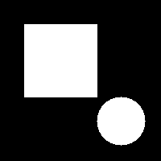
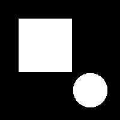
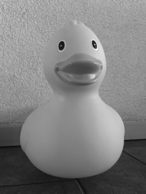
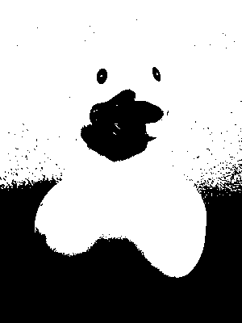
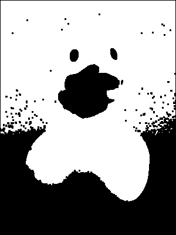
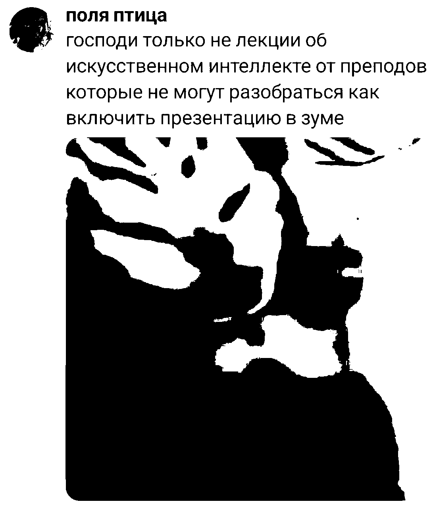
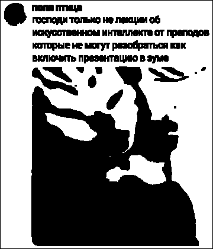

# ЛР1. Бинарная эрозия примитивом 3×3 (вариант 7)

Лабораторная по курсу «Компьютерное зрение».

**Вариант 7:** эрозия структурным элементом 3×3.

## Структура

```
vision-labs/
├── src/lab1/erosion.py   # binarize, erode_library, erode_manual
├── src/lab2/             # задел под ЛР2
├── src/lab3/             # задел под ЛР3
├── tests/lab1/           # 45 тестов
└── docs/lab1/            # картинки для отчёта
```

## Запуск

```bash
uv sync --group dev         
uv run pytest tests/lab1 -v 
uv run pytest               
uv run ruff check .         
uv run ruff format --check .
```

Бенчмарк (медиана 7 прогонов после warmup, маски — `default_rng(7)`):

```bash
uv run python -c "
import sys, time, statistics, numpy as np
sys.path.insert(0, 'src')
from lab1.erosion import erode_library, erode_manual
rng = np.random.default_rng(0)
w0 = (rng.integers(0, 2, size=(32, 32)) * 255).astype('uint8')
erode_library(w0); erode_manual(w0)
for h, w in [(64, 64), (128, 128), (256, 256), (512, 512), (1024, 1024)]:
    rng = np.random.default_rng(7)
    img = (rng.integers(0, 2, size=(h, w)) * 255).astype('uint8')
    assert (erode_library(img) == erode_manual(img)).all()
    libs, mans = [], []
    for _ in range(7):
        t = time.perf_counter(); erode_library(img); libs.append((time.perf_counter() - t) * 1000)
        t = time.perf_counter(); erode_manual(img); mans.append((time.perf_counter() - t) * 1000)
    print(f'{h}x{w}: lib={statistics.median(libs):.3f}ms man={statistics.median(mans):.3f}ms')
"
```

## 1. Теоретическая база

Бинарное изображение — матрица из `0` (фон) и `255` (объект).
Получается из полутонового пороговой бинаризацией:

```
dst = 255, если src > thresh, иначе 0
```

Эрозия — базовая операция математической морфологии:
`A ⊖ B = { z | B_z ⊆ A }`. С примитивом 3×3 из единиц правило простое:
выходной пиксель белый тогда и только тогда, когда все 9 пикселей
его окрестности 3×3 белые. Границы объектов «съедаются» на 1 px,
тонкие детали и шум исчезают.

Граница — zero padding (вне изображения считается `0`), поэтому
внешняя рамка результата всегда чёрная, а объекты у края стираются.

## 2. Описание системы

Три функции в `src/lab1/erosion.py`:

- `binarize(gray, thresh=127)` — `np.where(gray > thresh, 255, 0)`.
- `erode_library(binary)` — `cv2.erode` ядром 3×3,
  `borderType=BORDER_CONSTANT, borderValue=0` (это и есть zero padding;
  значение по умолчанию у OpenCV другое, его надо задавать явно).
- `erode_manual(binary)` — тот же алгоритм без OpenCV: паддинг 1 px,
  девять сдвинутых срезов (по одному на элемент ядра) склеиваются
  побитовым `&`. Циклов нет, всё в C-коде NumPy:

```python
m = binary.astype(bool)
padded = np.pad(m, 1, mode="constant", constant_values=False)
top, mid, bot = padded[:-2, :], padded[1:-1, :], padded[2:, :]
out = (
    top[:, :-2] & top[:, 1:-1] & top[:, 2:]
    & mid[:, :-2] & mid[:, 1:-1] & mid[:, 2:]
    & bot[:, :-2] & bot[:, 1:-1] & bot[:, 2:]
)
```

## 3. Результаты работы и тестирования

Тесты: **45/45 зелёных**. Все ожидаемые матрицы захардкожены вручную
(`cv2.erode` для их вычисления не используется).

| Класс | Что проверяет |
|-------|---------------|
| `TestBinarize` (4) | семантика `>` при 127/0/255, shape/dtype |
| `TestErodeManual` (11) | 8 паттернов + случаи 1×1 + fuzz |
| `TestErodeLibrary` (10) | те же паттерны для OpenCV |
| `TestEquivalence` (18) | `library == manual` на паттернах и 9 случайных масках |
| `TestImageIO` (2) | PNG roundtrip бит-в-бит, JPEG грузится и бинаризуется |

Проверенные закономерности: белое 5×5 → белая внутренность 3×3;
квадрат 3×3 → один пиксель; одиночный пиксель и полосы у границы →
полное стирание.

Синтетика (прямоугольник + круг), до и после:

| Вход | Эрозия |
|---|---|
|  |  |

Реальное фото (резиновая уточка, `binarize(127) → erode`):

| Серое | Бинарное | Эрозия |
|---|---|---|
|  |  |  |

Фото: Pieter de derde, Wikimedia Commons, CC BY-SA 4.0
(`File:1 Yellow rubber duck.jpg`, уменьшено до 300×400).
Видно предел фиксированного порога (светлая стена тоже белая)
и эффект эрозии: шум подъеден, тёмные дыры (глаза, клюв) выросли.

Скриншот мема (`photos/photo_2@06-10-2026_21-55-55.jpg`,
исходный размер 1096×1280, без уменьшения), тот же пайплайн. Обе
реализации дают побитово одинаковый результат:

| Серое | Бинарное | Эрозия |
|---|---|---|
|  |  |  |

Здесь белое — фон, чёрное — буквы. Эрозия белого = дилатация чёрного:
буквы жирнеют и плывут (доля белого 0.612 → 0.586), тонкие штрихи
страдают сильнее всего. Классика: эрозия убивает светлые детали
на тёмном и отъедает светлый фон вокруг тёмных объектов.

Быстродействие (медиана 7 прогонов, случайные маски):

| Размер | OpenCV | Маски (NumPy) |
|--------|--------|---------------|
| 64×64 | 0.009 мс | 0.049 мс |
| 128×128 | 0.010 мс | 0.053 мс |
| 256×256 | 0.014 мс | 0.074 мс |
| 512×512 | 0.048 мс | 0.243 мс |
| 1024×1024 | 0.315 мс | 1.324 мс |

Разрыв стабильно ~4–5×: масочная версия делает константное число
векторных проходов и масштабируется так же ровно, как OpenCV.

## 4. Выводы

- Эрозия примитивом 3×3 «съедает» границы объектов на 1 px по всему контуру: одиночные пиксели и полосы у края стираются полностью, квадрат 3×3 схлопывается в один пиксель, а толстые объекты лишь худеют.
- На реальных фото эффект тот же: у уточки подъеден зернистый шум на стене, а тёмные дыры (глаза, клюв) выросли; в меме буквы пожирнели и поплыли (доля белого 0.612 → 0.586), потому что эрозия белого — это дилатация чёрного.
- Zero padding границ подтверждён тестами: внешняя рамка результата всегда чёрная, объекты, касающиеся края, исчезают целиком.
- Масочная реализация на NumPy (девять сдвинутых срезов через `&`) даёт побитово тот же результат, что OpenCV, на всех паттернах и случайных масках.
- OpenCV быстрее в ~4–5 раз на всех размерах (например, 0.048 мс против 0.243 мс на 512×512): он написан на C++ и работает без промежуточных булевых массивов. Масочная версия при этом масштабируется так же ровно — разрыв не растёт с размером кадра.

## 5. Источники

1. Документация OpenCV: `cv::erode`, `BORDER_CONSTANT`, `THRESH_BINARY`.
2. Документация NumPy: `pad`, `where`, срезы массивов.
3. Gonzalez R. C., Woods R. E. *Digital Image Processing*, гл. 9.
