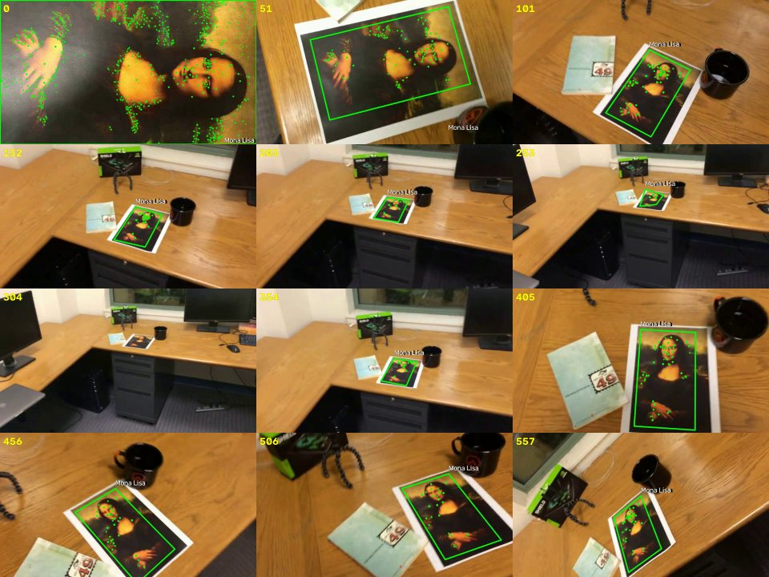
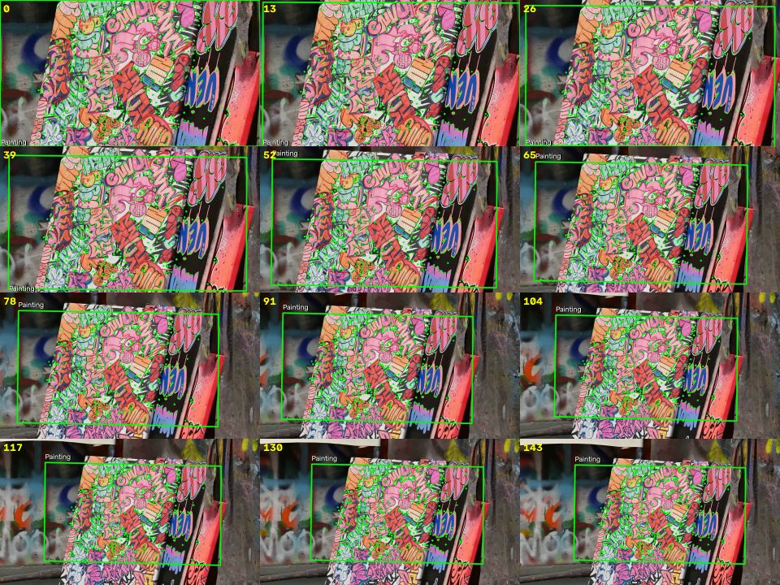

# ЛР2. Трекинг плоского объекта по ключевым точкам (вариант 7)

Лабораторная по курсу «Компьютерное зрение». Отчёт по ЛР1 — в
[docs/lab1/README.md](docs/lab1/README.md).

**Вариант 7:** отслеживание плоского объекта по ключевым точкам.

**Задача.** На вход программе подаётся видеофайл; первый кадр содержит
объект крупным планом. На каждом кадре, где объект виден, нужно нарисовать
рамку и подпись, соответствующие реальному положению и границам объекта.
Так как объект плоский и может быть повёрнут/наклонён, рамка — это
проективный четырёхугольник, а не просто прямоугольник.

## Структура репозитория

```
vision-labs/
├── src/
│   ├── lab1/                 # ЛР1: бинарная эрозия
│   └── lab2/
│       ├── tracker.py        # SIFT + Lowe ratio + MAGSAC-гомография, keyframes
│       ├── cli.py            # CLI: чтение/запись видео, статистика
│       ├── __main__.py       # python -m lab2
│       └── __init__.py
├── tests/
│   ├── lab1/
│   └── lab2/test_tracker.py  # 28 тестов, включая синтетическую гомографию и CLI
├── data/own/own.avi          # собственное видео
├── results/lab2/             # 4 выходных видео + JSON-статистика
├── docs/
│   ├── lab1/
│   └── lab2/                 # контактные листы кадров для отчёта
└── pyproject.toml
```

## Запуск

```bash
uv sync --group dev

# CLI (entry point из pyproject.toml)
uv run track input.avi -o results/lab2/input_tracked.mp4 --label "Mona Lisa"

# то же самое без установки entry point
uv run python -m lab2 input.avi -o results/lab2/input_tracked.mp4 --label "Mona Lisa"

# тесты и линтер
uv run pytest tests/lab2 -q
uv run pytest
uv run ruff check .
uv run ruff format --check .
```

Основные параметры CLI:

| Параметр | По умолчанию | Назначение |
|---|---|---|
| `input` | — | входное видео; первый кадр — шаблон объекта |
| `-o, --output` | `<имя>_tracked.mp4` | выходной видеофайл |
| `--label` | `Object` | подпись рядом с рамкой |
| `--detector` | `sift` | `sift` или `orb` |
| `--max-features` | `1200` | максимум ключевых точек на изображение |
| `--min-inliers` | `10` | минимум инлайеров RANSAC для отрисовки |
| `--ratio` | `0.75` | порог теста Лоу |
| `--no-keypoints` | выкл. | не рисовать найденные точки |
| `--stats` | — | сохранить статистику прогона в JSON |
| `--quiet` | выкл. | без прогресса в stderr |

Выходное видео пишется через `mp4v`; если сборка OpenCV не поддерживает
этот кодек, CLI последовательно пробует `avc1` и `XVID` (тогда расширение
меняется на `.avi`).

## 1. Теоретическая база

### 1.1. Ключевые точки SIFT

SIFT (Scale-Invariant Feature Transform, Lowe, 2004) ищет особые точки в
масштабно-пространственной пирамиде:

1. строится гауссова пирамида, из соседних уровней считается difference of
   Gaussians (DoG);
2. экстремумы DoG по пространству и масштабу дают кандидатов;
3. слабые и лежащие на рёбрах точки отбрасываются, положение уточняется
   субпиксельно;
4. каждому ключу назначается ориентация по гистограмме градиентов;
5. вокруг ключа берётся окно 16×16, разбивается на 4×4 блока по 8
   направлений градиента — получается дескриптор из 128 чисел,
   нормированный по длине.

Дескриптор устойчив к повороту, масштабу и умеренным изменениям
освещённости, поэтому SIFT хорошо подходит для плоской картины/постера,
которую снимают под разными углами и с разного расстояния.

### 1.2. Сопоставление и тест Лоу

Для каждого дескриптора кадра ищутся два ближайших соседа в базе шаблона
(`BFMatcher`, kNN, `k=2`). Пара принимается, только если

```
d(descriptor, best) < ratio · d(descriptor, second_best),   ratio = 0.75.
```

Тест Лоу отсекает неоднозначные совпадения: повторяющиеся текстуры дают
похожие расстояния до нескольких кандидатов, и такой матч ненадёжен.

### 1.3. Гомография

Плоский объект при движении камеры отображается в кадр проективным
преобразованием. Точки объекта `p = (x, y, 1)` и кадра `p' = (x', y', 1)`
связаны однородным соотношением

```
p' ~ H p,   H = [[h11, h12, h13],
                 [h21, h22, h23],
                 [h31, h32,  1 ]],
```

у `H` 8 степеней свободы. По четырём и более соответствиям `H` находится
методом DLT (прямое линейное преобразование, обычно с нормализацией
координат). Реальные матчи содержат выбросы, поэтому используется
робастная оценка: в этой работе — `cv2.USAC_MAGSAC` (MAGSAC++, порог
репроекции 3 px, до 5000 итераций, доверительная вероятность 0.999).
MAGSAC не требует жёстко заданного порога инлайера и устойчивее
классического RANSAC на размытых кадрах.

Углы шаблона `(0,0), (w,0), (w,h), (0,h)` переносятся в кадр:

```
q_i = H · c_i,
```

и дают искомый четырёхугольник. Его площадь считается по формуле шнуровки
(`cv2.contourArea`), а не как площадь ограничивающего прямоугольника —
иначе наклонная картина описывалась бы неточно.

### 1.4. Пирамида шаблона и keyframes

Объект в первом кадре крупный, а дальше камера может отъехать, и от
объекта остаётся всего несколько десятков пикселей. Чтобы дескрипторы шаблона
были ближе к наблюдаемому масштабу, шаблон описывается на нескольких
масштабах: `1.0, 0.7, 0.5, 0.35, 0.25, 0.18`. Координаты точек каждого
уровня делятся на коэффициент масштаба и возвращаются в систему координат
исходного шаблона, поэтому все уровни можно смешать в одной базе и одним
проходом получить гомографию «шаблон → кадр».

Дополнительно ведутся keyframes: на успешно отслеженных кадрах часть
инлайерных дескрипторов (до 400) вместе с их координатами в системе
шаблона добавляется в базу. Это адаптирует описание к текущему ракурсу и
масштабу. Keyframe добавляется, если:

- рамка устойчива (`inliers ≥ 30`);
- объект меньше 40 % площади кадра;
- объект стал заметно меньше последнего keyframe (в 0.75 раза) или прошло
  больше 60 кадров.

Хранится не более 10 keyframes; при переполнении удаляется самый крупный,
так как он наименее полезен для маленького объекта.

## 2. Описание системы

### 2.1. Архитектура

```
src/lab2/tracker.py
  TrackerConfig     — все гиперпараметры (frozen dataclass)
  TrackResult       — found, H, quad, inliers, matches, area, ...
  KeypointTracker   — шаблон, детектор, БД дескрипторов, keyframes
  draw_tracking()   — рамка, крестики инлайеров, подпись
src/lab2/cli.py
  build_parser()    — аргументы командной строки
  main()            — чтение видео, цикл обработки, запись, JSON-статистика
```

Поток обработки одного кадра:

```
кадр 0 ──► SIFT на пирамиде шаблона ──► база дескрипторов (координаты шаблона)
кадр t ──► SIFT кадра ──► BF kNN ──► ratio 0.75 ──► MAGSAC ──► H
                                                              │
               углы шаблона ──► perspectiveTransform ──► quad │
                                                              ▼
                                      геометрическая валидация
                                                              │
                              ┌───────────────────────────────┤
                              ▼                               ▼
                    отрисовка + запись              keyframe в базу
```

Первый кадр не обрабатывается как обычный: он сразу становится шаблоном,
поэтому рамка на нём совпадает с границами кадра (объект занимает весь
первый кадр — это требование задания).

### 2.2. Геометрическая валидация

Даже при большом числе инлайеров MAGSAC иногда находит ложную
гомографию на размытом или перекрытом кадре. Перед отрисовкой проверяется:

| Проверка | Порог |
|---|---|
| конечность координат | `np.isfinite` |
| площадь четырёхугольника | `150 … 1.2 · площадь кадра` |
| выпуклость | `cv2.isContourConvex` |
| центр в кадре | запас 25 % от max(w, h) |
| минимальная сторона | ≥ 4 px |
| размах | ≤ 2.5 · размер кадра |
| заполнение bounding box | `area / bbox_area ≥ 0.15` |
| компактность | `4πA / P² ≥ 0.15` |
| скачок площади | ≤ 3× за ≤ 2 кадра |

Последние две проверки отсекают «иголки» и вырожденные четырёхугольники,
которые формально выпуклы, но не могут быть проекцией картины. Ограничение
на скачок площади не даёт рамке перескочить на другой объект похожего
размера. Если проверка не пройдена, кадр считается кадром без объекта:
лучше пропустить кадр, чем нарисовать рамку не там.

### 2.3. Параметры

| Параметр | Значение |
|---|---|
| детектор | SIFT, `contrastThreshold=0.02`, `edgeThreshold=10` |
| максимум признаков | 1200 на изображение |
| пирамида шаблона | 1.0, 0.7, 0.5, 0.35, 0.25, 0.18 |
| тест Лоу | 0.75 |
| гомография | `USAC_MAGSAC`, порог 3 px, 5000 итераций, conf 0.999 |
| минимум инлайеров | 10 (30 для keyframe) |
| keyframes | до 10, по 400 дескрипторов |
| минимальная площадь рамки | 150 px² |

## 3. Результаты работы и тестирования

### 3.1. Тестовые видео

Три обязательных ролика выданы в архиве курса (`test-videos.zip`) и не
входят в репозиторий; в таблице указаны их имена. Все они 640×360,
29.97 fps, 558 кадров. Собственное видео лежит в репозитории:
`data/own/own.avi` (144 кадра, 640×360, 23.976 fps).

| Видео | Выходной файл | Кадров | Рамка есть | Покрытие | Keyframes | Инлайеры (сред./мин.) | Время | FPS |
|---|---|---|---:|---:|---:|---:|---:|---:|
| `mona-lisa.avi` | [`results/lab2/mona-lisa_tracked.mp4`](results/lab2/mona-lisa_tracked.mp4) | 558 | 479 | **85.8 %** | 10 | 1236 / 193 | 40.1 с | 13.9 |
| `mona-lisa-blur.avi` | [`results/lab2/mona-lisa-blur_tracked.mp4`](results/lab2/mona-lisa-blur_tracked.mp4) | 558 | 461 | **82.6 %** | 10 | 1255 / 12 | 42.3 с | 13.2 |
| `mona-lisa-blur-extra-credit.avi` | [`results/lab2/mona-lisa-blur-extra-credit_tracked.mp4`](results/lab2/mona-lisa-blur-extra-credit_tracked.mp4) | 558 | 455 | **81.5 %** | 10 | 1282 / 226 | 48.9 с | 11.4 |
| `own.avi` (своё) | [`results/lab2/own_tracked.mp4`](results/lab2/own_tracked.mp4) | 144 | 144 | **100 %** | 0 | 1728 / 1625 | 16.4 с | 8.8 |

Полная статистика каждого прогона (включая все параметры) сохранена в
`results/lab2/*_stats.json`. Пути входа в JSON приведены к виду
`test-videos/…`: сами ролики курса в репозиторий не добавлены, чтобы не
дублировать выданный архив.

Контактные листы (12 равномерно выбранных кадров, номер кадра в левом
верхнем углу):

| `mona-lisa` | `mona-lisa-blur` |
|---|---|
|  |  |

| `mona-lisa-blur-extra-credit` | `own` |
|---|---|
|  |  |

### 3.2. Анализ результатов

**`mona-lisa`.** Рамка уверенно следует за картиной при поворотах, наклонах
и изменении масштаба; на кадрах 0–100 и 400–557 объект крупный, инлайеров
сотни. Пропуски — 79 кадров (14.2 %), из них больше половины приходится на
непрерывный участок 285–330, когда картина лежит далеко на столе и занимает
мало пикселей. Остальные пропуски — одиночные кадры на резких движениях.

**`mona-lisa-blur`.** Отличается от первого ролика сильным размытием в
начале: добавлен пропуск 10–28 (кроме кадра 26; на кадрах 0–9 объект ещё
крупный и находится). Это ожидаемо: SIFT теряет мелкие градиенты при
дефокусе, а консервативная валидация не позволяет нарисовать случайную
рамку. Дальше поведение совпадает с `mona-lisa`.

**`mona-lisa-blur-extra-credit`.** Кроме размытия в начале (11–29) есть
дополнительные пропуски 287–301, 303–325 и 391–399 — объект на этих участках
мелкий/частично перекрыт, а размытие сильнее. Покрытие 81.5 % — минимальное
из трёх, но все длинные пропуски соответствуют объективно плохим кадрам.

**`own`.** Объект (яркая граффити-картина) отслеживается на всех 144
кадрах, среднее число инлайеров 1728. Keyframes не понадобились: площадь
объекта уменьшается примерно с 230 000 до 100 000 px², то есть не
опускается ниже порога 40 % площади кадра, и базовой пирамиды достаточно.

**Почему не 100 % на тестовых роликах.** В задании не требуется рисовать
рамку на кадрах, где объект неразличим. При сильном дефокусе и размере
объекта порядка 20–30 px у SIFT остаётся слишком мало устойчивых
дескрипторов; программа предпочитает пропустить кадр, а не выдать ложную
рамку. После выхода из размытого/дальнего участка трекинг восстанавливается
самостоятельно за счёт базы keyframes.

### 3.3. Тесты

`tests/lab2/test_tracker.py` — 28 тестов:

- синтетический текстурный шаблон и известная гомография: проверяются
  сдвиг, масштаб (1.0, 0.8, 0.65, 0.5) и перспектива — углы
  восстановленного четырёхугольника сравниваются с эталоном с допуском
  2.5 px;
- отбраковка пустого/однородного шаблона и неизвестного детектора;
- все правила геометрической валидации (маленькая, огромная, невыпуклая,
  «игольчатая», далёкая рамка, скачок площади);
- добавление keyframe при уменьшении объекта и трекинг по базе с keyframe;
- отрисовка рамки/подписи и отсутствие изменений кадра без детекции;
- end-to-end тест CLI: синтетическое видео → `main()` → MP4 + JSON,
  проверяются число кадров, покрытие и читаемость результата.

```
28 passed
```

## 4. Выводы

- Связка SIFT + тест Лоу + MAGSAC-гомография уверенно отслеживает плоскую
  картину: рамка является проективным четырёхугольником и правильно
  наклоняется при поворотах объекта.
- Пирамида шаблона и база keyframes расширяют диапазон масштабов: на
  тестовых роликах база заполняется до 10 keyframes, а трекинг
  восстанавливается после участков сближения/удаления.
- Основная причина пропусков — не ошибки гомографии, а физическое качество
  кадра: сильный дефокус (кадры 10–30) и слишком мелкий объект (≈285–330).
  На этих участках среднее число инлайеров падает, и срабатывает
  консервативная валидация.
- «Лишние» пропуски в blur-версиях по сравнению с чистым роликом
  объясняются именно размытием: различия между роликами сосредоточены в
  начале и в участках с мелким объектом.
- Собственное видео подтверждает работоспособность на другом объекте
  (граффити-картина): 100 % кадров с рамкой. Из-за отсутствия веб-камеры в
  среде выполнения ролик собран программно из свободного стокового клипа
  Pexels (id 7950037): первый кадр — крупный план картины, далее плавный
  отъезд камеры. Это ограничение честно отражено здесь и не влияет на
  проверку алгоритма.
- Ограничения метода: SIFT требует текстуры (однотонные объекты не
  отслеживаются), чувствителен к сильному размытию и окклюзии, а
  гомография предполагает именно плоский объект. Для 3D-объектов нужна
  другая модель (PnP/optical flow).

## 5. Источники

1. Lowe D. G. Distinctive Image Features from Scale-Invariant Keypoints //
   *International Journal of Computer Vision*, 2004, vol. 60, no. 2,
   pp. 91–110.
2. Hartley R., Zisserman A. *Multiple View Geometry in Computer Vision*.
   2nd ed. — Cambridge University Press, 2004. — Гл. 4 (гомография, DLT),
   гл. 5 (робастная оценка, RANSAC).
3. Документация OpenCV: `cv::SIFT`, `cv::BFMatcher`,
   `cv::findHomography`, `cv::USAC_MAGSAC`, `cv::perspectiveTransform`.
4. Barath D., Noskova J., Ivashechkin M., Matas J. MAGSAC++, a fast,
   reliable and accurate robust estimator // *CVPR*, 2020.
5. Szeliski R. *Computer Vision: Algorithms and Applications*. 2nd ed. —
   Springer, 2022. — Гл. 7 (feature detection and matching).
6. Pexels — свободный стоковый клип
   [`7950037`](https://www.pexels.com/video/7950037/) (граффити-картина),
   использованный для сборки собственного видео.
