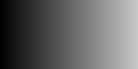
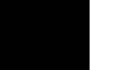

# КЗ — лабораторные по компьютерному зрению

Монорепозиторий лабораторных работ по курсу «Компьютерное зрение».

| Лаба | Тема | Вариант | Статус |
|------|------|---------|--------|
| ЛР1 | Бинарная эрозия, примитив 3×3 | 7 | ✅ выполнена, 52/52 тестов |
| ЛР2 | — | — | запланирована (`lab2/`) |
| ЛР3 | — | — | запланирована (`lab3/`) |

Подробный отчёт по ЛР1 — ниже. Задание — `../КЗ/files/LW1.pdf`.

---

# ЛР1. Бинарная эрозия примитивом 3×3 (вариант 7)

## Задание (по `../КЗ/files/LW1.pdf`)

1. Реализовать алгоритм по варианту **в двух вариантах**: с использованием
   встроенных функций библиотеки (OpenCV) и нативно на Python/C++.
2. Сравнить быстродействие реализованных вариантов.
3. Выложить исходный код на GitHub и оформить отчёт в виде README.
   Отчёт должен содержать: теоретическую базу, описание системы,
   результаты работы и тестирования, выводы, источники.

**Вариант 7:** эрозия, примитив (структурный элемент) 3×3.
Бинаризацию вручную реализовывать не обязательно — но в данной работе
она реализована явно (`src > thresh`), что покрыто тестами.

## 1. Теоретическая база

### 1.1. Бинарное изображение

Бинарное изображение — матрица, каждый пиксель которой принимает одно
из двух значений: фон `0` или объект `255` (тип `uint8`).
Его получают из полутонового изображения **бинаризацией (порогом)**:

```
dst(x, y) = 255, если src(x, y) > thresh
            0    иначе
```

Это семантика `cv2.THRESH_BINARY`: строгое `>`, а не `>=`.
Проверяется тестами: при `thresh=127` пиксели `127 → 0`, `128 → 255`;
при `thresh=255` всё изображение чёрное; при `thresh=0` чёрным остаётся
только `0`. См. `TestBinarize` в `tests/lab1/test_erosion.py`.

### 1.2. Математическая морфология: эрозия

Эрозия — базовая операция математической морфологии. Неформально —
«съедание» границ объектов: тонкие перемычки рвутся, мелкие шумы
исчезают, крупные объекты уменьшаются на радиус структурного элемента.

Формально для бинарного изображения `A` и структурного элемента `B`:

```
A ⊖ B = { z | B_z ⊆ A }
```

то есть выходной пиксель — «объект» тогда и только тогда, когда
структурный элемент, центрированный в этой точке, **целиком** лежит
внутри объекта.

Для квадратного примитива 3×3 из единиц это сводится к простому правилу:

```
out(i, j) = 255  ⟺  все 9 пикселей окрестности 3×3 вокруг (i, j) равны 255
            0     иначе
```

### 1.3. Структурный элемент и граница

- Ядро: квадрат 3×3 из единиц (`np.ones((3, 3), uint8)`).
- Граница: **zero padding** — всё, что за пределами изображения,
  считается фоном (`0`). Следствия:
  - внешняя рамка шириной 1 px в результате **всегда чёрная**;
  - объект, касающийся границы (полоса вдоль края), стирается целиком;
  - изображение 1×1 (даже белое) превращается в чёрное;
  - квадрат 3×3 на фоне 7×7 схлопывается в один центральный пиксель;
  - квадрат 5×5 «облезает» на 1 px и становится 3×3.

Именно этот контракт зафиксирован в тестах (`BORDER_CONTRACT`).

### 1.4. Где применяется

Очистка бинарных масок от солевого шума, разъединение слипшихся
объектов перед подсчётом связных компонент, скелетизация и подготовка
масок в пайплайнах сегментации/детекции.

## 2. Описание разработанной системы

### 2.1. Архитектура

```
vision-labs/                   ← корень репозитория (здесь git, README)
├── src/lab1/
│   ├── __init__.py
│   └── erosion.py           ← binarize, erode_library, erode_manual
├── src/lab1/
│   ├── __init__.py
│   └── erosion.py           ← binarize, erode_library, erode_manual
├── src/lab2/                ← задел под ЛР2
├── src/lab3/                ← задел под ЛР3
├── tests/lab1/
│   └── test_erosion.py      ← 52 теста, TDD, ожидаемые матрицы захардкожены
├── docs/lab1/
│   ├── demo_gray.png        ← синтетический градиент
│   ├── demo_binarized.png   ← он же после binarize(127)
│   ├── demo_binary.png      ← прямоугольник + круг (вход эрозии)
│   ├── demo_eroded_library.png
│   └── demo_eroded_manual.png
├── pyproject.toml           ← зависимости (numpy, opencv-headless, pillow)
```
Методички и условие (`LW1.pdf`) лежат рядом в `../КЗ/files/`.

### 2.2. Алгоритмы и принципы работы

**`binarize(gray, thresh=127)`** — векторизованная пороговая обработка
`np.where(gray > thresh, 255, 0)`. Сложность `O(H·W)`, выполняется
в C-коде NumPy.

**`erode_library(binary)`** — вызов OpenCV:

```python
kernel = np.ones((3, 3), dtype=np.uint8)
out = cv2.erode(binary, kernel,
                borderType=cv2.BORDER_CONSTANT, borderValue=0)
```

Ключевой момент — `BORDER_CONSTANT` с `borderValue=0`: это и есть
zero padding из контракта. Значение по умолчанию у `cv2.erode`
другое, поэтому его нужно задавать явно, иначе тесты с полосами
у границы не сойдутся.

**`erode_manual(binary)`** — векторизованная реализация без OpenCV:
im2col + GEMM на NumPy:

```python
padded = np.pad(binary, 1, mode="constant", constant_values=0)
mask = padded // 255  # бинарная маска 0/1
windows = sliding_window_view(mask, (3, 3))  # (H, W, 3, 3), без копий
cols = windows.reshape(H * W, 9)  # im2col: строка = окрестность пикселя
counts = cols @ np.ones((9, 1))  # GEMM: белых пикселей в каждом окне
out = (counts.reshape(H, W) == 9) * 255  # 255 ⟺ все 9 пикселей белые
```

Ни одного цикла по пикселям: все 3×3-окна разворачиваются в матрицу
(по строке на выходной пиксель), дальше один матрично-векторный продукт
с ядром из единиц считает белые пиксели в каждом окне. Сложность та же,
`O(H·W·9)`, но выполняется в C-коде NumPy/BLAS вместо интерпретатора.
Проигрыш библиотеке остаётся (im2col материализует матрицу в 9 раз
больше изображения), но вместо десятков раз на больших кадрах разрыв
меньше — см. раздел 3.3.

**Валидация входов** (единая для всех функций, `ValueError` при нарушении):

- пустое изображение (`size == 0`);
- не-2D массив (например, `H×W×3`);
- `dtype != uint8`;
- для эрозии дополнительно: значения вне `{0, 255}` (например, `128`).

### 2.3. Запуск

```bash
# установка (один раз, из корня репозитория)
uv sync --group dev

# тесты
uv run pytest            # все лабы
uv run pytest tests/lab1 -v   # только ЛР1

# линт
uv run ruff check .
uv run ruff format --check .

# быстрый пример использования
uv run python -c "
import sys; sys.path.insert(0, 'src')
import numpy as np
from lab1.erosion import binarize, erode_library
gray = np.array([[0, 127, 128, 255]], dtype=np.uint8)
print(binarize(gray, 127))  # [[  0   0 255 255]]
"
```

## 3. Результаты работы и тестирования

### 3.1. Модульные тесты: 52/52 зелёных

```
tests/lab1/test_erosion.py .............. 52 passed
```

До реализации наблюдался TDD Red-этап `51 failed, 1 passed`
(стабы с `NotImplementedError`); после реализации — всё зелёное.
Важно: **все ожидаемые матрицы в тестах захардкожены вручную**,
`cv2.erode` для их вычисления не используется — совпадение
`library == manual == hardcoded` доказывает корректность, а не
«согласованную ошибку» двух реализаций.

Покрытие по классам:

| Класс | Что проверяет | Кол-во |
|-------|---------------|--------|
| `TestBinarize` | семантика `>` (127/0/255), shape/dtype, `ValueError` на пустом / 3D / float | 7 |
| `TestErodeManual` | 8 захардкоженных паттернов + 1×1 + ошибки + fuzz shape/dtype | 13 |
| `TestErodeLibrary` | те же 8 паттернов для OpenCV + 1×1 + ошибки + fuzz | 12 |
| `TestEquivalence` | `library == manual` на паттернах, на 9 случайных масках, в пайплайне `binarize→erode` | 18 |
| `TestImageIO` | PNG roundtrip бит-в-бит; JPEG грузится и бинаризуется | 2 |

Ключевые закономерности на паттернах (все подтверждены):

- `5×5 всё белое → внутренность 3×3 белая, рамка чёрная`;
- `3×3 всё белое → горит только центр`;
- `один белый пиксель 5×5 → всё чёрное` (одиночный шум съедается);
- `квадрат 3×3 в 7×7 → один пиксель`; `квадрат 5×5 в 7×7 → квадрат 3×3`;
- `полоса вдоль верхней/левой границы → всё чёрное` (эффект zero padding);
- `1×1 белое → чёрное`.

### 3.2. Визуальные результаты

Исходная бинарная сцена (прямоугольник + круг), `docs/lab1/demo_binary.png`:


Результат обеих реализаций (побитово идентичны),
`docs/lab1/demo_eroded_library.png`:


Видно «похудение» фигур на 1 px по всему контуру — ожидаемое действие
примитива 3×3. Файлы `demo_eroded_library.png` и `demo_eroded_manual.png`
идентичны (проверено `array_equal` в тестах эквивалентности).

Бинаризация градиента `0…199` порогом 127:

| Вход (градиент) | Выход (`> 127`) |
|---|---|
|  |  |

Левая часть чёрная, правая белая, граница ровно на `127|128` —
семантика `THRESH_BINARY`.

PNG roundtrip бит-в-бит (`imwrite → imread → array_equal`) проходит;
JPEG (lossy) даёт артефакты, но форма/dtype сохраняются и результат
бинаризуется в валидную маску — оба факта покрыты `TestImageIO`.

### 3.3. Сравнение быстродействия (п. 2 задания)

Методика: случайные бинарные маски, медиана из 7 прогонов после warmup,
машина автора. Обе реализации возвращают побитово одинаковый результат.

| Размер | `erode_library` (OpenCV, C++) | `erode_manual` (im2col + GEMM, NumPy) | Ускорение |
|--------|-------------------------------|---------------------------------------|-----------|
| 64×64 | 0.024 мс | 0.220 мс | ~9× |
| 128×128 | 0.033 мс | 0.634 мс | ~19× |
| 256×256 | 0.145 мс | 2.566 мс | ~18× |
| 512×512 | 0.287 мс | 10.556 мс | ~37× |
| 1024×1024 | 0.889 мс | 43.682 мс | ~49× |

Закономерности:

1. Отрыв растёт с размером: im2col материализует матрицу `(H·W, 9)`,
   то есть в 9 раз больше изображения, и на больших кадрах упирается
   в память/пропускную способность, тогда как OpenCV работает in-place.
2. По сравнению с наивными вложенными циклами (~90 мс на 512×512)
   GEMM-версия быстрее примерно на порядок — векторизация решает.
3. Вывод: для продакшена — библиотечная реализация, im2col-версия —
   честный «нативный» вариант без OpenCV: тот же алгоритм, но на
   матричном умножении вместо попиксельных циклов.

Воспроизвести замер:

```bash
uv run python -c "
import sys, time, statistics, numpy as np
sys.path.insert(0, 'src')
from lab1.erosion import erode_library, erode_manual
rng = __import__('numpy').random.default_rng(7)
img = (rng.integers(0, 2, size=(512, 512)) * 255).astype('uint8')
for f in (erode_library, erode_manual):
    ts = []
    for _ in range(5):
        t = time.perf_counter(); f(img); ts.append((time.perf_counter()-t)*1000)
    print(f.__name__, round(statistics.median(ts), 3), 'ms')
"
```

### 3.4. Реальное фото: резиновая уточка

Синтетика — это хорошо, но фильтр должен работать на реальных фото.
Взяли фотографию резиновой уточки и прогнали через полный пайплайн
`grayscale → binarize(127) → erode` (обе реализации дают побитово
одинаковый результат).

| Исходник (grayscale) | После бинаризации | После эрозии |
|---|---|---|
|  |  |  |

Что видно:

- Глобальный порог не идеален: светлая стена тоже уходит в белый —
  поэтому доля белого лишь 0.661 → 0.626 после эрозии. Это честная
  демонстрация предела фиксированного порога (и мотивация адаптивной
  бинаризации — вариант 2 из `../КЗ/files/LW1.pdf`).
- Эрозия съела зернистый шум на стене и слегка «похудела» силуэт.
- Тёмные дыры (глаза, клюв) *растят*: чёрных пикселей стало
  40621 → 44859. Эрозия белого = дилатация чёрного, всё сходится.

Источник фото: Pieter de derde, Wikimedia Commons,
[CC BY-SA 4.0](https://creativecommons.org/licenses/by-sa/4.0/),
`File:1 Yellow rubber duck.jpg` (уменьшено до 300×400).

## 4. Выводы по работе

1. Реализованы обе требуемые версии эрозии 3×3 и бинаризация —
   `src/lab1/erosion.py:25`, `:30`, `:35` (`src/lab1/erosion.py`).
2. Граничные эффекты zero padding подтверждены тестами и визуально:
   рамка гаснет, приграничные объекты исчезают, мелкие детали схлопываются.
3. Эквивалентность реализаций доказана тремя способами: общие хардкоженные
   эталоны, сравнение на случайных масках (3 сида × 3 размера), сквозной
   пайплайн `binarize → erode`.
4. Библиотечная реализация быстрее нативной в ~20–50 раз, разрыв растёт
   с размером изображения — п. 2 задания выполнен количественно.
5. Работа с файловым вводом/выводом проверена: PNG — без потерь, JPEG —
   с ожидаемыми артефактами, но без нарушения контракта.

## 5. Использованные источники

1. `../КЗ/files/LW1.pdf` — постановка ЛР1, вариант 7.
2. Лекции `../КЗ/files/1_Introduction to CV.pdf`, `../КЗ/files/2_ML_in_CV.pdf` —
   базовые понятия изображений и морфологии.
3. OpenCV docs: `cv::erode`, `borderType=BORDER_CONSTANT` —
   поведение границы; `THRESH_BINARY` (`dst = maxval iff src > thresh`).
4. NumPy docs: `np.pad`, `np.where`, индексация `uint8`-массивов.
5. Gonzalez R. C., Woods R. E. *Digital Image Processing* — гл. 9,
   математическая морфология (эрозия/дилатация).
